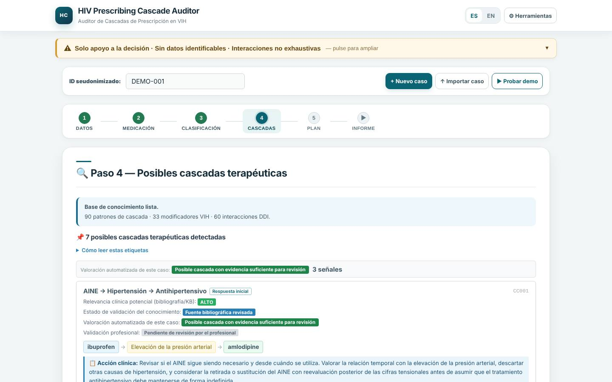
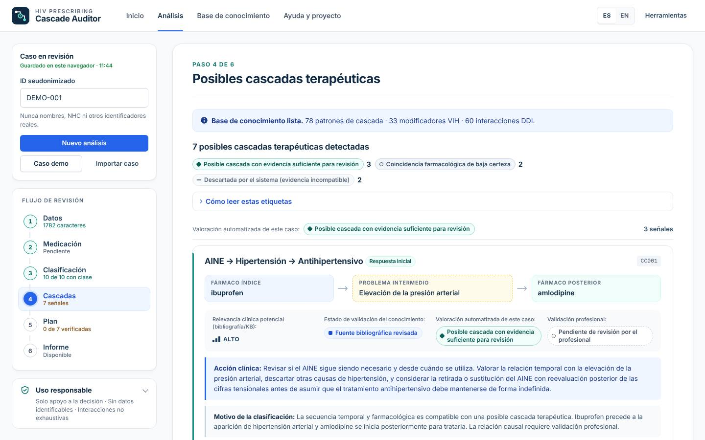
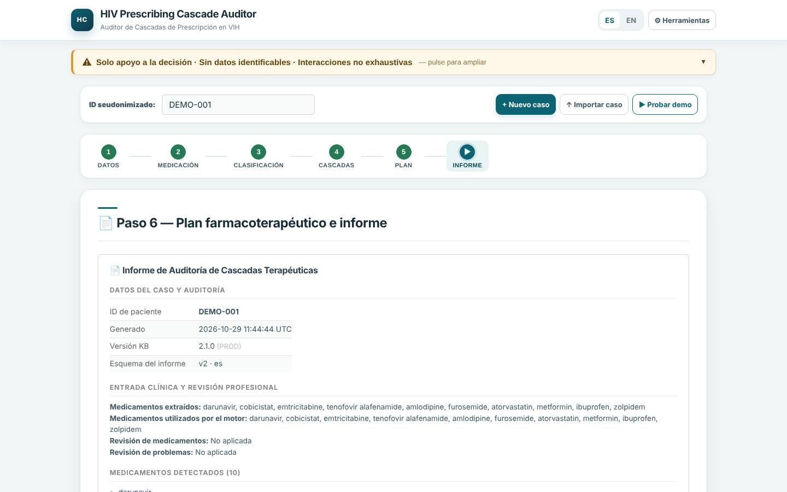
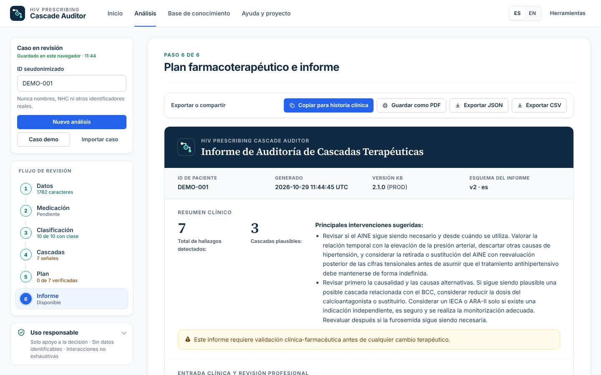
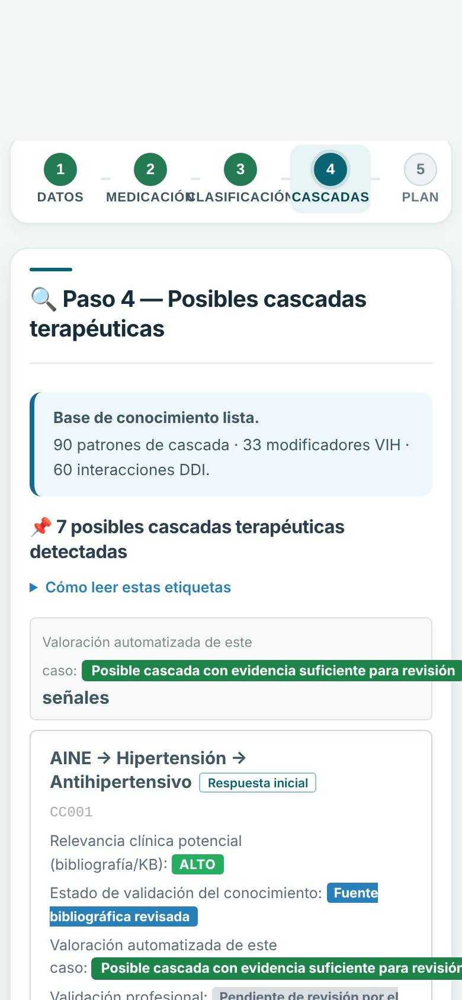
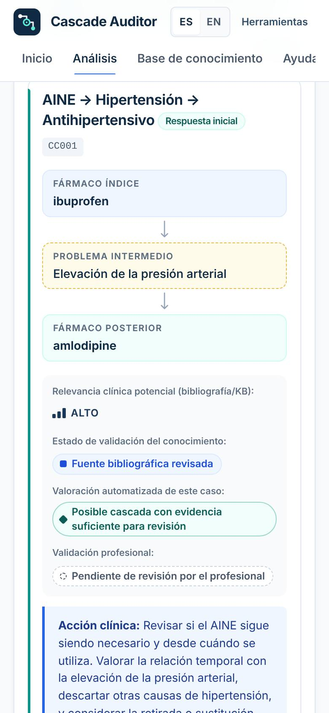

# Rediseño web — informe técnico

Rama: `claude/wizardly-noether-aoiw2h` · Punto de partida: `main` en `643d520` · Fecha: 2026-10-29

Alcance: cambio **exclusivamente de presentación**. No se modifica `clinical-engine.js`, `report-contract.js`, `reviewed-input-adapter.js`, `medication-review.js`, `problem-review.js` ni ningún fichero de `kb/` (verificado con `git diff --stat` vacío sobre esas rutas).

---

## 1. Auditoría inicial (resumen)

| Área | Hallazgo (dato objetivo) | Implicación para el rediseño |
|---|---|---|
| Arquitectura | SPA estática sin dependencias. Motor clínico DOM-free (`clinical-engine.js`) + capa UI/estado (`app.js`, ~4.200 líneas) + contrato de informe (`report-contract.js`). | El rediseño puede limitarse a `app.js` (render) y al shell HTML/CSS. |
| Render | `app.js` generaba casi todo el HTML clínico con estilos en línea y colores fijos. | Había que refactorizar los renderizadores a clases sin tocar los datos que muestran. |
| Tests | 23 suites, 6.039 aserciones, 0 fallos. Varias suites leen `index.html` como shell de la app y extraen literales de `app.js` (`loadDemoCase`, `runKBValidation`). | Riesgo de rotura al mover la app; los literales extraídos debían conservarse. |
| Seguridad | CSP `script-src 'self'`, sin scripts en línea, sin manejadores `on*`, `escHtml` sistemático, `no-referrer`. | La landing debía cumplir la misma política; nada de CDN ni fuentes externas. |
| Persistencia | `localStorage` (`hiv_cascade_state`, `hiv_cascade_lang`). | Mismo origen para landing y app → la preferencia de idioma y el caso se comparten. |
| GitHub Pages | Publicación desde la raíz de `main`, sin build, sin `CNAME`. | Mantener ficheros en la raíz y rutas relativas. |
| Defectos de UI detectados | Toasts con entidades literales (`Revisi&oacute;n`) por doble escape y apilamiento ilimitado; indicador de guardado nunca activo (HAL-12); idioma no restaurado sin caso guardado; botón «Finalizar» sin acción; recuento de «patrones» incluía 12 reglas fusionadas no ejecutadas; contraste insuficiente de insignias (HAL-04). | Corregidos (ver §5); ninguno altera la lógica clínica. |
| Defectos clínicos previos (no tocados) | HAL-01: «Dejó de tomar amlodipino…» sigue generando CC004 `possible_but_incomplete` (reproducido en la batería golden). | Fuera de alcance por la restricción de no modificar el motor; queda como pendiente. |

**Mapa de riesgos y mitigación**

| Riesgo | Mitigación aplicada |
|---|---|
| Alterar resultados clínicos al reescribir renderizadores | Captura «golden» en navegador antes/después (§6) con comparación exacta. |
| Romper exportaciones | Descargas reales JSON/CSV/caso/KB y portapapeles verificadas en E2E. |
| Romper Pages / rutas | Landing y app en la raíz, rutas relativas, test de independencia de dominio. |
| Debilitar la CSP | Misma CSP en ambas páginas, verificada por test; sin recursos externos. |
| Mostrar categorías inventadas | Solo se usan las 5 clasificaciones del motor, las 4 dimensiones existentes y los valores `confidence` reales (un valor inesperado se muestra tal cual, nunca se reasigna). |

## 2. Decisiones de diseño principales

- **Dirección**: minimalismo científico. Fondo claro, tinta azul petróleo `#102A43`, azul tecnológico `#2563EB` para acciones, turquesa para estados completados, dorado institucional solo en el reconocimiento.
- **Ajuste de paleta justificado**: para texto se usan `#0F766E` (5,5:1) en lugar de `#0D9488` (3,7:1, insuficiente para AA) y `#7A5C22` en lugar de `#B89554` (2,6:1); los tonos originales quedan como acentos gráficos.
- **Tipografía autoalojada**: Inter (interfaz) y Source Serif 4 (titulares y reconocimiento), subconjunto latino, ~150 KB en total, licencia OFL incluida.
- **Identidad**: símbolo en escalera (fármaco índice → problema intermedio → fármaco posterior) con un anillo de revisión en el nodo intermedio, que es donde actúa la revisión farmacoterapéutica. Sin cruces, cerebros ni robots.
- **Resultados**: cada señal muestra la cadena rotulada (índice / problema intermedio / posterior) y las 4 dimensiones en celdas etiquetadas. Cada estado tiene forma de marcador propia (rombo, semicírculo, anillo, guion, línea discontinua) además del texto: el color nunca es el único portador de significado.
- **Premio**: denominación exacta, sin logotipos oficiales, con nota explícita que distingue el proyecto premiado del software.

## 3. Arquitectura final

```
/ (raíz publicada)
├── index.html        Web pública (landing) — ES por defecto, EN vía landing.js
├── app.html          Herramienta — vistas por hash: #analysis · #knowledge · #about
├── site.config.js    publicUrl / awardUrl (vacíos por defecto)
├── assets/css        base.css (tokens) · app.css · landing.css
├── assets/fonts      Inter, Source Serif 4 (+ licencias)
├── assets/brand      mark.svg · apple-touch-icon.png · icon-512.png · og-image.png
└── scripts           set-public-url.js · render-brand-assets.js · qa/ (golden, compare, e2e)
```

Navegación de la herramienta: **Inicio** (landing) · **Análisis** (flujo de 6 pasos) · **Base de conocimiento** (catálogo real de reglas activas, búsqueda ES/EN, filtros) · **Ayuda y proyecto** (premio, qué hace / qué no hace, buenas prácticas, autoría, aspectos legales). «Nuevo análisis» y «Resultados» no se añadieron como secciones separadas: ya existen como acción (botón) y como pasos 4–6 del flujo; duplicarlos habría creado menús sin función propia.

Las rutas hash solo contienen el nombre de la vista (nunca datos clínicos), funcionan en cualquier hosting estático y sobreviven a recarga y enlace directo.

## 4. Ficheros

**Nuevos**: `app.html`, `landing.js`, `kb-catalog.js`, `site.config.js`, `site.webmanifest`, `favicon.svg`, `robots.txt`, `assets/**`, `scripts/set-public-url.js`, `scripts/render-brand-assets.js`, `scripts/brand/og-image.html`, `scripts/qa/{golden,compare,e2e}.js`, `tests/site-redesign.test.js`, `docs/redesign/**`.

**Modificados**: `index.html` (ahora landing), `app.js` (render por clases, vistas, estado del flujo, toasts, guardado, idioma), `ui-static-i18n.js` (claves nuevas ES/EN, sin emojis), `tests/{browser-security,static-i18n,report-wiring,reviewed-input-wiring}.test.js` (apuntan a `app.html`; nuevas comprobaciones de la landing), `tests/run.js`, `README.md`, `CHANGELOG.md`.

**Eliminados**: `styles.css`, `theme-siafcmo.css` (sustituidos por `assets/css/`).

## 5. Mejoras de experiencia de usuario

- Barra lateral con el caso (ID seudonimizado + aviso), acciones (nuevo, demo, importar) y **estado real por paso** (caracteres de la nota, revisión en borrador/confirmada, fármacos con clase, nº de señales, nº verificadas).
- Cabecera de paso con «Paso N de 6» y foco movido al título al navegar (lectores de pantalla).
- Paso 4: resumen de señales por nivel de valoración, leyenda plegable, tarjetas con cadena rotulada, 4 dimensiones, notas de acción/interacción/motivo y evidencia desplegable.
- Paso 5: barra de progreso de verificación y control segmentado con `aria-pressed`.
- Paso 6: barra de exportación fija, informe con estructura de documento (cabecera, metadatos, resumen con cifras, secciones) y PDF que incluye la evidencia desplegada.
- Toasts legibles (sin entidades), máx. 3 en pantalla, pausa al pasar el ratón/foco, errores persistentes hasta cerrar.
- Móvil: el contenido clínico aparece antes que el aviso de uso; pasos con desplazamiento horizontal; cadena vertical; sin desplazamiento horizontal de página de 320 a 1280 px.
- Landing: aviso «Hay un caso en curso guardado en este navegador» (comprueba solo que existe, no muestra contenido).

## 6. Verificación de conservación de funcionalidades

**Equivalencia clínica (navegador, Chromium)** — `scripts/qa/golden.js` sobre la versión original (`index.html` en `643d520`) y la nueva (`app.html`), 7 casos: demo, `examples/example_note.txt`, amlodipino→edema→furosemida, indicación alternativa, Symtuza, nota sin cascada y discontinuación. Para cada caso se compara: informe ES y EN (`buildReport()`), CSV ES y EN, texto para historia clínica ES y EN, y el informe + CSV tras confirmar la revisión de medicación/problemas y registrar un veredicto profesional.
Resultado: **14/14 pares idénticos** (normalizando solo marcas de tiempo `generated_at`/`confirmed_at`), 0 errores de consola.

**Funcionalidades verificadas en E2E (`scripts/qa/e2e.js`, 48/48)**: carga del demo, navegación por los 6 pasos, veredicto por teclado, exportación de informe JSON/CSV (descarga real), copiar para historia clínica (portapapeles), exportación del caso JSON y CSV desde Herramientas, exportación KB fuente/operativa, vista de impresión, eliminar datos, importar caso con veredicto, catálogo KB y búsqueda, recarga y enlace directo de vistas, cambio de idioma (landing → app y dentro de la app), *skip link*, sin peticiones a terceros.

**Accesibilidad**: axe-core 4.10 (WCAG 2.0/2.1/2.2 A y AA) sin infracciones en landing ES/EN, pasos 1, 2, 4, 5, 6, base de conocimiento y «Acerca». Es una verificación automatizada; no sustituye una auditoría manual con tecnologías de apoyo ni pruebas con usuarios.

## 7. Resultados de pruebas

| Prueba | Antes | Después |
|---|---|---|
| `npm test` (suites / aserciones / fallos) | 23 / 6.039 / 0 | 24 / 6.181 / 0 |
| Golden clínico en navegador | — | 14/14 idénticos |
| E2E navegador | — | 48/48 |
| axe WCAG A/AA | — | 0 infracciones (9 vistas) |
| Desbordamiento horizontal 320–1280 px | — | ninguno |

Ejecución de las pruebas de navegador (requieren Playwright, no forman parte de CI):

```bash
python3 -m http.server 8080
AXE_PATH=/ruta/axe.min.js node scripts/qa/e2e.js http://localhost:8080/
node scripts/qa/golden.js http://localhost:8080/ app.html after.json
```

## 8. Incidencias y limitaciones pendientes

1. **Premio — enlace oficial**: no se ha encontrado una noticia o resolución oficial verificable; `awardUrl` queda vacío y el enlace oculto.
2. **Premio — coherencia terminológica**: el título oficial del proyecto menciona «inteligencia artificial», mientras que la herramienta, tal como está implementada, funciona con reglas y una base de conocimiento curada, sin modelos de IA. La web conserva literalmente el título premiado y describe la herramienta tal como es; conviene que los autores confirmen el texto de vinculación proyecto ↔ herramienta.
3. **Afiliaciones**: el repositorio no contiene afiliaciones verificadas; solo se muestran nombres y cotitularidad.
4. **HAL-01 (motor)**: la frase «dejó de tomar X» no desactiva el fármaco; no corregido por estar fuera del alcance (motor clínico).
5. **README** declaraba 40 cascadas generales; la KB PROD actual tiene 78 activas (90 entradas, 12 fusionadas). La herramienta muestra ahora el dato real; la tabla del README sigue requiriendo actualización editorial.
6. **Open Graph**: hasta configurar `publicUrl`, `og:image` es relativa y algunas redes no mostrarán la vista previa.
7. **Cambio de origen**: `localStorage` es por origen; al pasar al dominio propio los casos guardados en la URL anterior no se trasladan solos.
8. No se ha probado en Safari/Firefox reales ni en lectores de pantalla (solo Chromium headless).

## 9. Publicación en GitHub Pages

Sin cambios de configuración: **Settings → Pages → Deploy from a branch → `main` / (root)**. Tras fusionar, la raíz sirve la landing y `app.html` la herramienta. No hay paso de compilación.

## 10. Conexión del futuro dominio

1. `site.config.js` → `publicUrl: 'https://<dominio>/'`.
2. `node scripts/set-public-url.js` (y `--check` en revisiones posteriores).
3. GitHub → Settings → Pages → *Custom domain* + registros DNS indicados por GitHub; activar *Enforce HTTPS*.
4. Comprobar la vista previa social con la URL definitiva.

## Capturas

| Antes | Después |
|---|---|
|  |  |
|  |  |
|  |  |

Nuevas: [landing](screenshots/after-landing-hero.jpg) · [reconocimiento](screenshots/after-landing-award.jpg) · [base de conocimiento](screenshots/after-desktop-knowledge.jpg).
